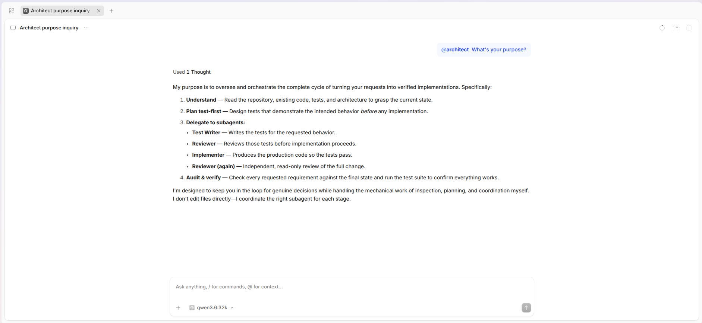

# OpenCode Sandbox Kit



A Docker Sandbox Kit workload for running [OpenCode](https://opencode.ai/) as a sandboxed coding agent while exposing its web interface to the host.

The workload is based on Docker's published OpenCode sandbox template and repins OpenCode to the version declared by the Kit.

## What this provides

- **OpenCode web UI** running inside the sandbox on port `4096`
- **Sandboxed agent execution** with the Docker Sandbox Kit agent workload
- Persistent OpenCode application state for each sandbox
- Shared global OpenCode configuration and skills
- Global agent definitions for a general coding workflow
- Optional credential injection for:
  - GitHub
  - OpenRouter
  - Exa
  - Context7

- Network policy restricting sandbox egress to the services OpenCode needs
- Local Ollama access through the Docker host
- Automatic registration of the Sandbox Kit MCP gateway when one is provided

The project deliberately keeps the **coding-agent workflow global** rather than tying the workload to a particular application repository.

## Repository contents

| File                           | Purpose                                                            |
| ------------------------------ | ------------------------------------------------------------------ |
| `opencode-workload.yaml`       | Sandbox Kit workload definition                                    |
| `opencode-workload.dockerfile` | Image definition and pinned OpenCode installation                  |
| `opencode.json`                | Global OpenCode configuration, including the coding-agent workflow |
| `opencode-context.md`          | Global `AGENTS.md` content supplied to OpenCode                    |
| `agents/`                      | Global agent prompt definitions                                    |

The application repository being worked on is separate from this repository. It becomes the sandbox's workspace when the sandbox is launched.

## Requirements

You need:

- Docker Desktop or Docker Engine with Docker Sandbox / the `sbx` CLI and Sandbox Kit v3 support
- An Ollama installation:
  - **Local:** Running on the same machine as Docker (uses default host networking).
  - **Remote:** Running on another machine on your local network (requires setting `OLLAMA_HOST` and a local mixin).
- The Ollama model you want OpenCode to use

## Running the workload

The simplest way to use the workload from this repository is to let `sbx` build the Kit from the local directory:

```bash
sbx run . /path/to/your/project
```

The project directory supplied to `sbx` becomes the OpenCode workspace.

You can also use the current directory as the workspace:

```bash
sbx run .
```

The workload publishes OpenCode's web interface on container port `4096`. The Sandbox Kit runtime assigns the corresponding host port.

## OpenCode version

The workload currently defaults to OpenCode **2.0.22**.

The version is a Kit argument and is installed explicitly during the image build:

```yaml
args:
  version:
    default: "2.0.22"
```

This keeps the published Kit capability version and the actual OpenCode binary in sync.

## Agent workflow

The global OpenCode configuration defines a general coding workflow with four agents:

- **Architect** — plans implementation work without changing files
- **Test writer** — writes tests without changing production code
- **Implementer** — implements production code without changing tests
- **Reviewer** — reviews code without changing it

The repository's `AGENTS.md` rules provide the general behavioral constraints shared by these agents, including inspecting the existing project before changing it, preserving working-tree changes, treating tests as part of the specification, keeping scope controlled, and reporting meaningful verification results.

Project-specific instructions remain with the project being worked on rather than being built into this workload.

## Credentials

Credentials are optional and are handled through Docker Sandbox Kit's credential capabilities rather than being stored in the repository or sandbox filesystem.

The workload supports:

| Service    | Environment variable |
| ---------- | -------------------- |
| GitHub     | `GITHUB_TOKEN`       |
| OpenRouter | `OPENROUTER_API_KEY` |
| Exa        | `EXA_API_KEY`        |
| Context7   | `CONTEXT7_API_KEY`   |

A credential only needs to be configured when the corresponding service is needed.

How credentials are stored and bound is handled by Docker Sandbox Kit rather than by this repository. Do not put API keys into `opencode.json`, the workload YAML, or a committed `.env` file.

## Ollama Configuration

The workload uses `{env:OLLAMA_HOST}` to locate the Ollama server. By default, the workload environment falls back to `http://host.docker.internal:11434`, allowing the sandbox to reach an Ollama instance running directly on the Docker host without any special setup.

### Scenario A: Ollama running on the Docker host (Default)

If Ollama is installed locally on your machine and listening on its standard endpoint, no extra configuration is required.

Make sure Ollama is running before starting the sandbox:

```bash
ollama serve
```

The workload's default network policy permits host access, and OpenCode will automatically connect to `http://host.docker.internal:11434`.

### Scenario B: Ollama running on a remote LAN machine

If your Ollama server runs on a dedicated GPU box or a different machine on your local network (e.g., `192.168.1.100`), two simple steps are required:

#### 1. Set OLLAMA_HOST in your host shell

Docker Sandbox Kit passes your host session's environment through to the sandbox. Export the address of your remote Ollama server before running `sbx`:

```bash
export OLLAMA_HOST=http://192.168.1.100:11434
```

_(Add this to your `~/.bashrc` or `~/.zshrc` to persist it)._

#### 2. Create a local network mixin

Docker Sandbox Kit enforces a default-deny network policy. Because the remote machine is not the Docker host, you must grant the sandbox permission to reach that specific LAN IP and port.

Create a local mixin file (for example, `local-network-mixin.yaml`):

```yaml
# syntax=docker/sandbox-kit:3
schemaVersion: "3"
kind: mixin
displayName: Local Network Access
description: Allows egress to private LAN services like remote Ollama

capabilities:
  - type: com.docker.sandbox/network-policy@1
    config:
      runtime:
        allow:
          - 192.168.1.100:11434
```

Replace `192.168.1.100:11434` with your remote server's actual IP and port.

#### 3. Ignore your mixin in Git

Keep your private network topography out of the public git history by adding the mixin to `.gitignore`:

```gitignore
local-network-mixin.yaml
```

#### 4. Launch the sandbox with the mixin

Pass `--kit` when running `sbx` to compose your local network policy onto the workload:

```bash
sbx run . --kit ./local-network-mixin.yaml /path/to/your/project
```

The sandbox will inherit your `OLLAMA_HOST` environment variable, OpenCode will connect directly to `http://192.168.1.100:11434/v1`, and the mixin will permit the traffic through the sandbox firewall.

### Workflow tip: Avoid passing `--kit` every time with `sbx env`

If you use a local mixin or run OpenCode frequently, you can save your kit composition into an `sbx` environment so you don't have to pass flags manually every time.

Create an environment that pairs the workload with your mixin:

```bash
sbx env create opencode . --kit ./local-network-mixin.yaml
```

Once created, you can launch a named sandbox in any workspace with just:

```bash
sbx env run opencode --name opencode-workload-agents-test28 /path/to/your/project
```

## Adding access to other local services

You can expand the same mixin to permit access to any other local or self-hosted services that your coding agent needs to query (e.g., ComfyUI, a local database, or an internal documentation server).

Simply add the host and port under `allow` in your mixin:

```yaml
capabilities:
  - type: com.docker.sandbox/network-policy@1
    config:
      runtime:
        allow:
          - 192.168.1.100:11434 # Remote Ollama
          - 192.168.1.100:8188 # Local ComfyUI
          - "*.internal.lan:443" # Local domain
```

## MCP

When Docker Sandbox Kit provides an MCP gateway, the workload's startup hook registers that gateway in OpenCode's configuration.

The configuration is **merged** with the existing `opencode.json` rather than replacing it. This preserves the workload's OpenCode settings and any other MCP configuration already present.

If no MCP gateway is provided, the gateway-specific configuration is simply not used.

## Network policy

The workload uses a restrictive runtime network policy rather than unrestricted sandbox egress.

The public policy includes the external services required by the workload, including:

- GitHub
- OpenRouter
- Exa
- Context7
- OpenCode
- package and schema services needed by OpenCode and its tooling
- the host Ollama service

Personal LAN services do not belong in the public workload. Add those through a local mixin instead.

This keeps the published workload useful to other users without giving every sandbox access to services that only exist on the author's network.

## Why the application repository is separate

This repository defines the **coding environment**, not a particular software project.

The workload therefore contains:

- the OpenCode installation
- global OpenCode configuration
- global agent definitions
- general agent instructions
- credentials and network capability declarations

The project being worked on is supplied separately when the sandbox is launched.

This makes the same workload reusable across different repositories without embedding project-specific paths or development instructions into the Kit.

## Development

To modify the workload itself, edit the Kit files in this repository and run it directly from the checkout.

Docker Sandbox Kit v3 supports building and running Kits directly from their source directories, so a registry is not required for local development.

For descriptor validation:

```bash
docker buildx build . -f opencode-workload.yaml --output type=cacheonly
```

To run the local workload against a project:

```bash
sbx run . /path/to/your/project
```

To compose a local mixin:

```bash
sbx run . --kit ./local-network-mixin.yaml /path/to/your/project
```

A mixin cannot run by itself; it is composed onto a workload.
